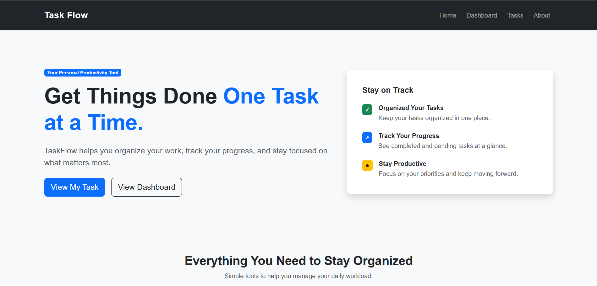
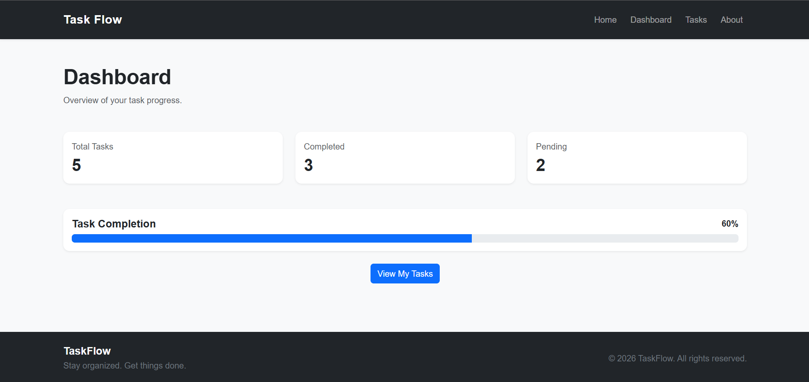
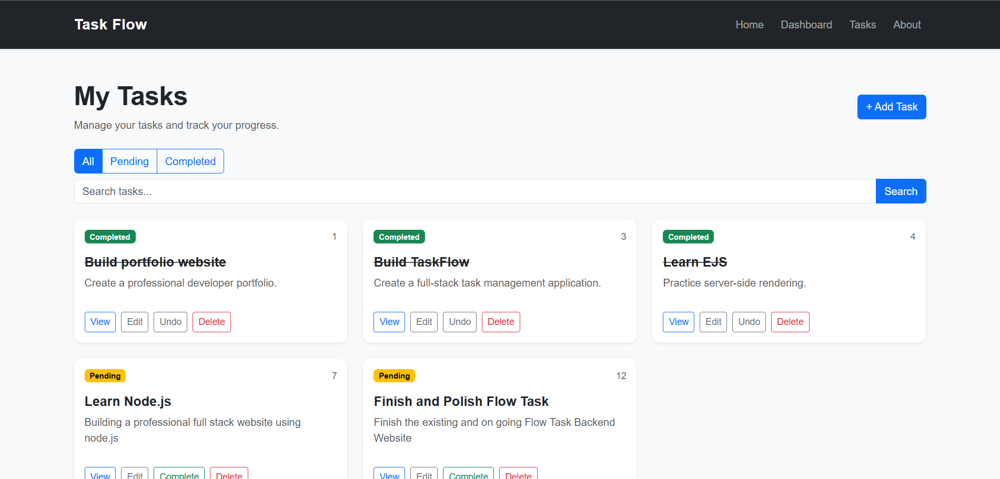
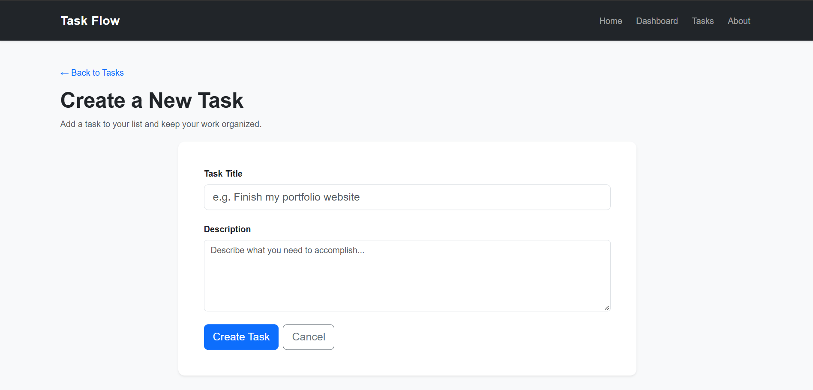

# TaskFlow — Task Management Application

TaskFlow is a task management web application built with Node.js, Express.js, and EJS. It allows users to organize their tasks, monitor progress, and manage their daily activities through a simple, responsive interface.

## Features

- Create new tasks
- View task details
- Edit existing tasks
- Delete tasks with confirmation
- Mark tasks as completed or pending
- Search tasks by title or description
- Filter tasks by completion status
- View dashboard statistics
- Validate task input
- Display custom 404 error pages
- Store task data in a JSON file
- Responsive interface using Bootstrap

## Technologies Used

- Node.js
- Express.js
- EJS
- JavaScript
- Bootstrap 5
- HTML5
- CSS3
- JSON file storage

## Installation

### Prerequisites

- Node.js
- npm

### Steps

1. Clone or download this repository.

2. Open the project folder in your terminal.

3. Install the project dependencies:

   ```bash
   npm install
   ```

4. Start the application:

   ```bash
   npm start
   ```

   For development with automatic server restarts, run:

   ```bash
   npm run dev
   ```

5. Open your browser and visit:

   http://localhost:3000

## Data Storage

TaskFlow stores task information in `data/tasks.json`. The application reads and updates this file when tasks are created, edited, deleted, or marked as completed.

## Screenshots

### Home Page



### Dashboard



### Tasks Page



### Add Task Page



## Project Purpose

This project was developed as a portfolio project to practice backend development, server-side rendering, routing, form handling, input validation, and file-based data management.

## Future Improvements

- Add a database such as MongoDB or PostgreSQL
- Implement user registration and authentication
- Add task deadlines and priorities
- Deploy the application online

## Author

**Jayce Barneey**

Developer Portfolio Project
